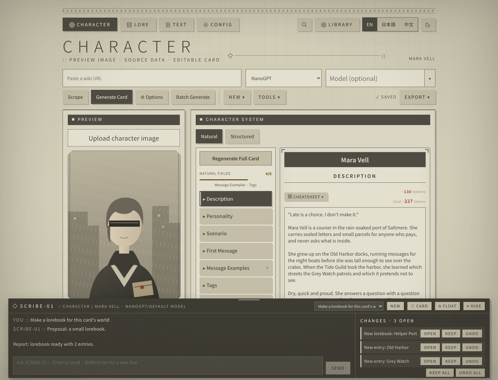
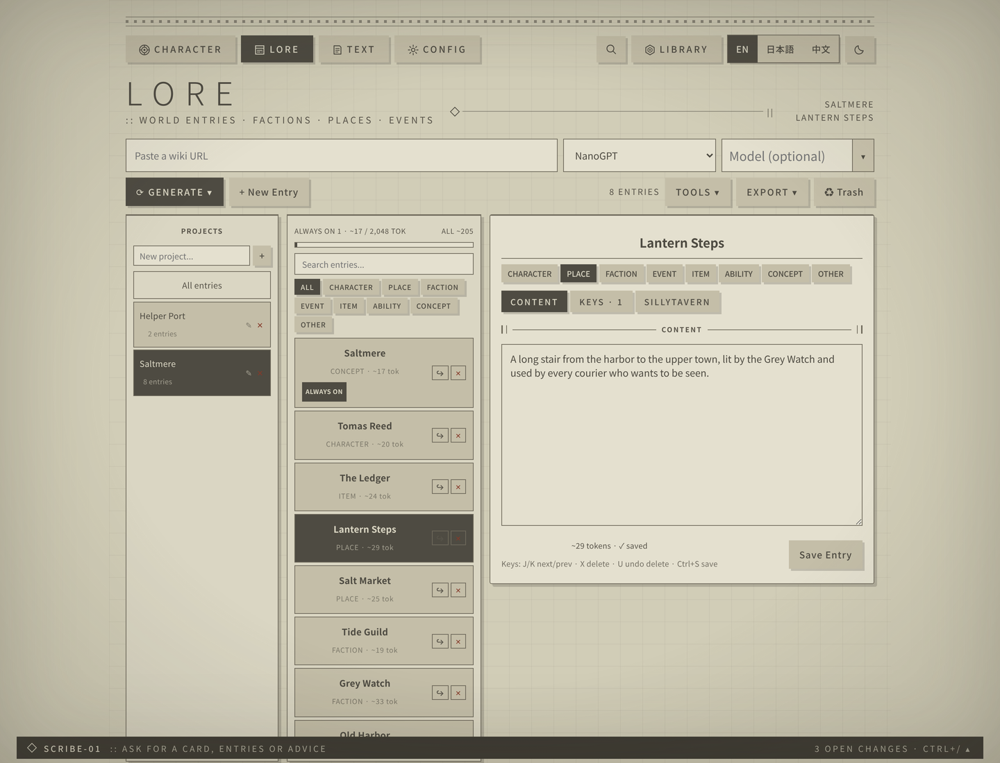

# Character Card Studio — v2.6 Update

This update adds a helper you can talk to, a new look across the whole app, and card import. Your existing cards,
lorebooks and stories are kept as they are.

> **After updating:** start the app with `start.bat` / `start.sh` as usual. It installs one new frontend package
> (the bundled font) by itself, and opens the browser once the backend is ready.

---

## Highlights

- **SCRIBE-01**, a helper in CHARACTER, LORE and TEXT: ask in plain words and it writes or edits cards, builds
  lorebooks and their entries, reads your TEXT stories and explains SillyTavern. Every change can be kept or undone.
- **A new look** inspired by NieR:Automata's menus: staff-line borders, big thin titles, dark header strips, one quiet
  accent color, darker screen edges, and a key-hint footer. Light and dark mode.
- **Tidier toolbars:** the less-used actions moved into menus (NEW / TOOLS / EXPORT, GENERATE in LORE), and the LORE
  entry editor has CONTENT / KEYS / SILLYTAVERN tabs.
- **Import cards** from a PNG, JSON or CHARX, made here or anywhere else, with their portrait and lorebook.
- **Better writing checks:** first message point of view, tense and length; more stock phrases; new prose-scan
  habits; automatic clean-up of generated text.

---

## SCRIBE-01

Press **Ctrl+/** or click the **SCRIBE-01** bar at the bottom of the screen.

- **Where it lives:** a console along the bottom. Drag its top edge to make it taller, **▾ HIDE** to shrink it to the
  bar, or **⧉ FLOAT** to turn it into a window you can drag and resize anywhere. It remembers where you left it.
- **What it can do:** create and edit cards (including the Structured view), create lorebooks and add, edit or trash
  entries, read TEXT stories and their characters, and explain SillyTavern settings, card writing and lorebooks.
- **It knows what is open.** "Tighten this description" works on the open card; "Make a lorebook for this card's
  world" builds one for it; "Shorten this entry" works on the selected entry.
- **Every change is listed** on the right with **OPEN**, **KEEP** and **UNDO** (plus KEEP ALL / UNDO ALL). UNDO
  refuses if you edited the item since, so your own work is never overwritten. Unsaved edits are saved before it reads
  anything, and the studio reloads what it changed.
- **Her personality:** a patient, precise instructor on the surface, a composed, duty-first support unit underneath,
  and fully aware that she is a tool built to make cards. You can just chat with her. Edit her in
  `backend/config/helper_persona.txt`; the work rules always apply on top of it.
- **⇩ CARD** downloads SCRIBE-01 as a SillyTavern card, with her glossary as its lorebook, so you can talk to her
  there too.
- **Glossary:** `backend/config/helper_glossary.json` works like a lorebook for the helper: notes on terms that come
  up in the conversation are added to its prompt. Edit freely.

---

## The new layout

- Every page starts with a staff-line border, the studio tabs, and a header: a large title, a `::` subtitle, and on
  the right what is open (the card, the lorebook and entry, or the story).
- Panels have dark header strips; buttons are flat blocks with an offset shadow; hover and selection turn dark.
- **CHARACTER toolbar:** Scrape, Generate Card, Options, Batch Generate, then **NEW ▾** (blank card, import),
  **TOOLS ▾** (Audit, Interview, View Source) and **EXPORT ▾** (Card JSON, V3 JSON, CHARX, embedded lorebook).
- **LORE toolbar:** **GENERATE ▾** (from a URL, several URLs, a prompt, deep extraction), New Entry, **TOOLS ▾**
  (Clean Keywords, Test Activation, Links, Trash all entries), **EXPORT ▾** (SillyTavern .json, Send to SillyTavern,
  Quick Replies, Bible / Data Bank, DeepLore) and Trash.
- A menu item that isn't available says what it needs ("open a card first").
- The footer lists the keys for the current page.
- The design system is written up in [DESIGN.md](DESIGN.md) with a drop-in stylesheet, for use in other projects.

---

## Import cards

**CHARACTER → NEW ▾ → Import card** accepts:

- a card **PNG** (V2 or V3 data inside), which also becomes the portrait;
- a card **JSON**: V1, V2 or V3, from this app or any other;
- a **.charx** (the card and its images).

The card comes in as a new card. If it has an embedded lorebook, that becomes a LORE project and is attached to the
card for export. Cards exported from this app come back with their Structured profile and Character's Note.

---

## Writing

- **First message style** (⚙ Options): point of view (first, second or third person), tense, and greeting length.
  Used for Generate Card, Batch Generate, regenerating the first message, example messages and greetings.
- **Prose scan habits** (TEXT → Critic, and card warnings): "not X, but Y" emphasis, narrating what doesn't happen,
  a reply that repeats the other speaker's words as a question, em-dash overuse, and paragraphs that all open the same
  way. Card warnings also flag text that reads like a model refusal.
- **40 more stock phrases** in `backend/config/ai_cliches.txt`.
- **Clean-up of generated text:** straight quotes, `...` for ellipses, no stray HTML, no doubled spaces or extra blank
  lines, no "Name:" in front of a greeting. Your own typing is never changed.

---

## Fixes

Highlights from a full review (every detail is in the [changelog](CHANGELOG.md)):

- Saving settings, presets or a lore entry with only some fields no longer blanks the others.
- Card saves and exports always keep tags and greetings as lists and the profile as an object.
- The app works in a private window or with site storage blocked.
- Every API error comes back as a readable message.
- The browser opens only once the backend is ready, so the start-up log no longer fills with proxy errors.
